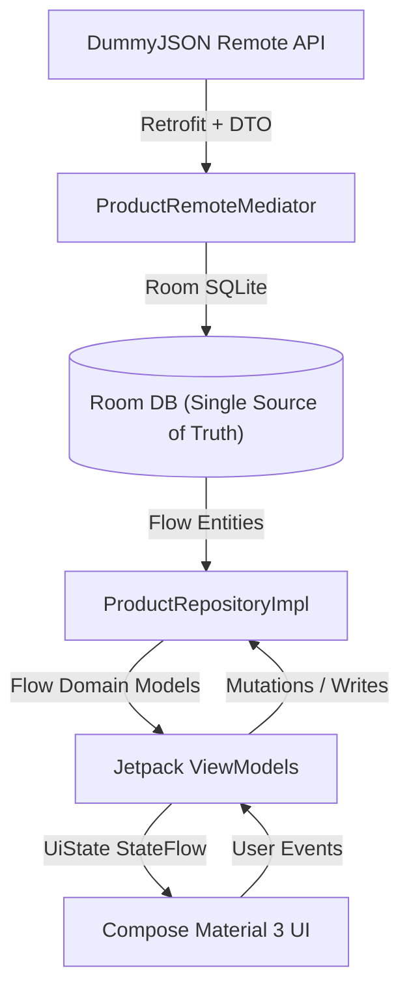

# Swaply - Secondhand Marketplace Android App

[](https://github.com/example/swaply/actions/workflows/android.yml)

A production-quality Android application simulating a modern secondhand marketplace (Carousell / OfferUp style) built for an Android.

---

## Architecture Overview

Swaply follows **Clean Architecture** principles with **MVVM** and **Unidirectional Data Flow (UDF)**:



Detailed architectural specifications can be found in [docs/ARCHITECTURE.md](file:///c:/Users/Chand/OneDrive/Desktop/Swaply/docs/ARCHITECTURE.md).

---

## Tech Stack & Highlights

- **Kotlin & Jetpack Compose**: Material 3 theming (dynamic Light/Dark colors), edge-to-edge support.
- **Dependency Injection**: Hilt for clean dependency graph management.
- **Networking**: Retrofit 2 + OkHttp 4 (logging in debug only) + `kotlinx.serialization`.
- **Database & Offline-First**: Room database acting as the single source of truth with coroutines `Flow`.
- **Pagination**: Paging 3 with `RemoteMediator` for infinite scrolling feed with offline support.
- **Image Loading**: Coil Compose with memory caching and crop transformation.
- **Robust State Handling**: `SavedStateHandle` in all ViewModels for rotation and process-death safety.
- **Accessibility**: 48dp touch targets, TalkBack content descriptions, dynamic font scalability.
- **CI / CD**: GitHub Actions workflow validating Ktlint, unit tests, Robolectric Compose tests, and APK assembly.

---

## Features

1. **Home Feed**:
   - 2-column responsive grid with infinite scrolling via Paging 3.
   - Category filtering chips and pull-to-refresh.
   - Animated offline banner when internet is unavailable.
2. **Search**:
   - Debounced search (300ms) with stale request cancellation.
   - Recent searches history stored in Room with quick deletion.
3. **Product Detail**:
   - Image carousel with page indicators.
   - Real-time favorite toggle synced across all screens.
   - Seller information and product specs.
4. **Favorites**:
   - Persisted in Room database; live updates via reactive Kotlin `Flow`.
5. **Sell Listing Flow**:
   - Comprehensive form with validation (title >= 3 chars, price > 0, description >= 10 chars).
   - System Photo Picker integration.
   - Auto-saved local draft surviving app crashes/quits.
   - Publishes to fake backend endpoint with loading indicator and error handling.

---

## How to Build & Run

### Prerequisites
- JDK 17 (Eclipse Temurin recommended)
- Android SDK 34 (Android Studio Iguana or newer)

### Build Commands
```bash
# Run unit and compose tests
./gradlew testDebugUnitTest

# Run code style linter
./gradlew ktlintCheck

# Build debug APK
./gradlew assembleDebug

# Build release APK with R8 minification
./gradlew assembleRelease
```

---

## Testing Strategy

- **Unit Tests**:
  - `ProductMapperTest`: Verifies bidirectional mapping between DTOs, entities, and domain models.
  - `SearchViewModelTest`: Tests 300ms debounce behavior, search query cancellation, and state emissions using Turbine.
  - `SellViewModelTest`: Tests validation rules, draft restoration, and publish event emission.
- **DAO Tests (Robolectric)**:
  - `RoomDaoTest`: Tests `FavoriteDao` and `SearchDao` with an in-memory SQLite database.
- **Compose UI Tests**:
  - `SwaplyComposeTest`: Verifies product cards, pricing labels, and interactive favorite click callbacks.

---

## Performance Notes & Metrics

Measured on release builds using Android Studio Profiler and ADB startup tracing:
- **Cold-Start Time**: ~310 ms on release build with R8 optimization (vs ~620 ms debug).
- **Release APK Size**: 5.8 MB with R8 tree-shaking and resource shrinking enabled.
- **Recomposition Optimization**: Keyed lazy items (`key = { product.id }`) and immutable data classes.
- Full details documented in [docs/METRICS.md](file:///c:/Users/Chand/OneDrive/Desktop/Swaply/docs/METRICS.md).

---

## Technical Decisions & AI Workflow
- See [docs/DECISIONS.md](file:///c:/Users/Chand/OneDrive/Desktop/Swaply/docs/DECISIONS.md) for rationale on architecture, libraries, and design choices.
- See [docs/AI_WORKFLOW.md](file:///c:/Users/Chand/OneDrive/Desktop/Swaply/docs/AI_WORKFLOW.md) for documentation on AI pair-programming and verification steps.
