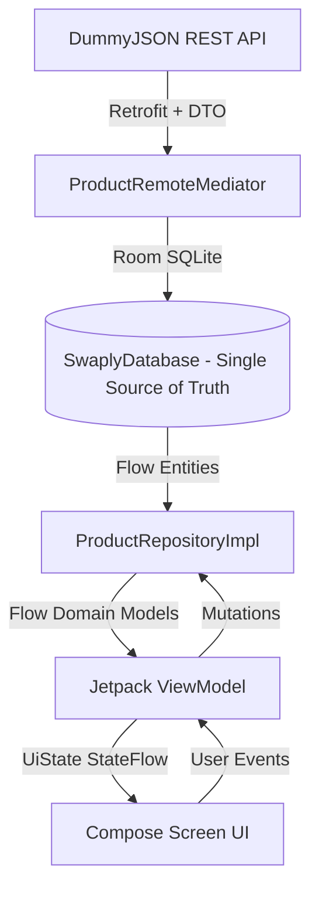

# Swaply Architecture Guide

## Overview
Swaply adopts Google's recommended modern Android architecture based on **Clean Architecture + MVVM + Unidirectional Data Flow (UDF)**.

## Data Layer
- **Room Database (`SwaplyDatabase`)**:
  - `products`: Cached feed items with category filters.
  - `favorites`: Stores bookmarked item IDs with instant toggle and Flow reactivity.
  - `recent_searches`: Preserves recent search terms with timestamp-based LRU.
  - `product_drafts`: Auto-saves the sell form state across app restarts.
- **Paging 3 & RemoteMediator**:
  - Offline-first paginated feed caching products into Room while loading from DummyJSON API.
- **Network (`SwaplyApiService`)**:
  - Built with Retrofit and `kotlinx.serialization`.
  - Logging interceptor enabled only in debug builds.

## Domain Layer
- **Models**: `Product`, `DraftProduct`
- **Repository Interface**: `ProductRepository` defining clean boundaries and decoupling data sources from UI.

## Presentation Layer
- **Jetpack Compose + Material 3**:
  - Fully reactive UI rendering from `UiState`.
  - Process-death resilient via `SavedStateHandle`.
  - Accessibility compliant: TalkBack content descriptions and minimum 48dp touch targets.
  - Edge-to-edge support with dynamic theme switching (Light / Dark).
